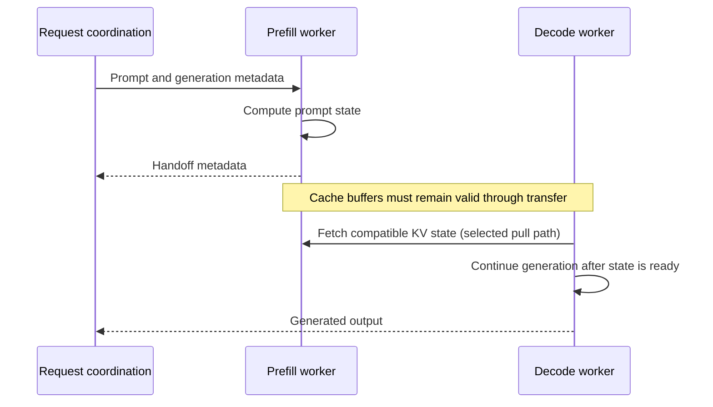

## Separate two kinds of work

**Prefill/decode disaggregation** places prompt processing and continued generation on distinct workers. A request still has one logical context, but different workers advance it at different stages. This is separate from splitting layers of one model across a pipeline.

A customer may need a fast first response to long prompts while maintaining smooth token streaming for many active users. Prefill and decode can compete for resources when they share one engine. Separate worker pools permit independent scaling or placement, but introduce a handoff on the request's critical path.

This diagram illustrates a pull-based handoff. Implementations can use other transfer directions, initiation policies, and output ordering. A generic diagram must not be used as a promise about every engine connector.

## Name the control path and data path

The control path assigns work and exchanges identities, locations, and completion information. The data path moves KV bytes. Sending a small handoff message through an orchestrator does not imply routing the entire cache through it.

Dynamo's [two-GPU disaggregated example](https://github.com/ai-dynamo/dynamo/blob/73014901d4e7610358fcf28535418ba9c5f50812/examples/backends/vllm/launch/disagg.sh) selects Qwen3-0.6B, separate prefill/decode workers, and NIXL connector roles. The [vLLM connector facade](https://github.com/vllm-project/vllm/blob/9a56d4fec6b0a30a0a989f1cd06cd3c2f7325619/vllm/distributed/kv_transfer/kv_connector/v1/nixl/connector.py) identifies the compatibility alias `NixlConnector` with the pull connector in this inspected source. These local examples explain the configuration shape; independently pinned repositories still require runtime compatibility checks before execution.

## The handoff has a budget

The destination needs usable state before dependent decode computation. Its delay includes scheduling and coordination, transfer setup, bytes moved, and any wait before execution. Transfer time depends on the effective path under load, not the network adapter's advertised peak bandwidth alone.

Compatible model configuration, tokenization, KV layout, and cache ownership are correctness requirements. Cancellation and worker failure complicate lifetimes: a source block cannot be recycled merely because the frontend no longer wants the answer. Inspect the connector's completion and cleanup handling.

Disaggregation can help when interference or independent scaling dominates. It can hurt small jobs where transfer and orchestration cost outweigh the benefit. Shared-cache pooling can complement this architecture, but a cache store is not a mandatory component of every prefill/decode split.

**Check yourself:** Does a fast RDMA link prove that disaggregation will improve first-token latency? No. Compare the full handoff cost and reduced queue/interference against the original workload's latency distribution.

## Explore the implementation

| Repository chapter | What to inspect |
| --- | --- |
| [Dynamo stage handoff](/architecture/dynamo/prefill-decode/) | Role-specific execution and continuation metadata |
| [vLLM connector lifecycle](/architecture/vllm/kv-connectors/) | Transfer readiness and failed receives |
| [SGLang stage disaggregation](/architecture/sglang/stage-disaggregation/) | Request handoff and staging lifetime |
