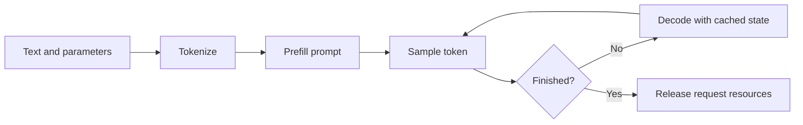

## A request is a sequence of dependent computations

A model does not receive a string and return a paragraph in one operation. The frontend converts input into [tokens](/glossary/#token): integer IDs from a model-specific vocabulary. A token can represent a word, part of a word, punctuation, or another encoded unit. Text length and token count therefore differ, and the tokenizer must match the model.

For a decoder-style text model, **[prefill](/glossary/#prefill)** processes the prompt and builds attention state. Its output scores can produce the first generated token. **[Decode](/glossary/#decode)** then repeatedly processes newly generated input and samples the next token, reusing earlier attention state. Sampling chooses from model scores; it can be greedy or probabilistic.

This is a conceptual lifecycle. An engine may split prefill into chunks and mix them with decode work from other requests. Speculative decoding can propose several tokens before verification. The conceptual stages remain useful without implying one fixed kernel or batch per stage.

## Follow the ownership

The API layer owns validation and response formatting. The scheduler owns the decision about which request advances next. Model workers own device execution, while the cache manager tracks the attention-state allocations they use. Output processing converts token IDs back into text and observes completion conditions.

In vLLM, [AsyncLLM.generate()](https://github.com/vllm-project/vllm/blob/9a56d4fec6b0a30a0a989f1cd06cd3c2f7325619/vllm/v1/engine/async_llm.py) registers a request and yields results from a per-request collector. [EngineCore.step()](https://github.com/vllm-project/vllm/blob/9a56d4fec6b0a30a0a989f1cd06cd3c2f7325619/vllm/v1/engine/core.py) schedules work, executes the model, and updates request state from the output. These are different responsibilities and may run in different processes.

## Streaming does not mean one network chunk per token

For a short prompt asking for ten output tokens, prefill can produce the first token; later decode iterations produce subsequent tokens until a stop condition or limit. The frontend can send partial text while generation continues. Token boundaries, decoded text boundaries, and transport chunks need not align. vLLM's [output collector](https://github.com/vllm-project/vllm/blob/9a56d4fec6b0a30a0a989f1cd06cd3c2f7325619/vllm/v1/engine/output_processor.py) can merge deltas when the producer gets ahead of the response consumer.

This separation also explains cancellation: closing the client stream must eventually stop scheduler work and reclaim state. It is insufficient to stop displaying text while the device continues generating. To investigate latency, distinguish time waiting to start, prompt processing, repeated generation, and response delivery.

**Check yourself:** Why can a request with a short answer still take a long time to show its first token? Queueing, tokenization, a long prompt, and other work ahead of its prefill can all contribute.

## Explore the implementation

| Repository chapter | What to inspect |
| --- | --- |
| [vLLM request ownership](/architecture/vllm/request-lifecycle/) | Rendering, collectors, cancellation, and output delivery |
| [SGLang request messages](/architecture/sglang/request-lifecycle/) | Frontend state and process boundaries |
| [DeepInfer offline requests](/architecture/deepinfer/offline-request-lifecycle/) | Sequence admission and borrowed native outputs |
