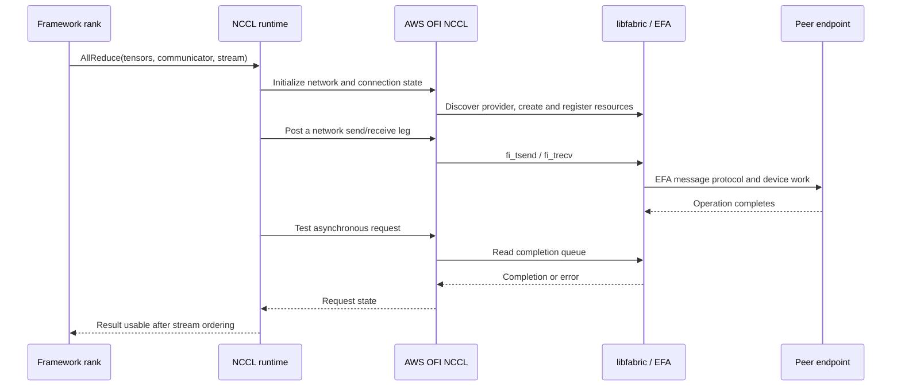

## Configuration and boundary

Read this trace as a source-verified interface path, not a certified deployment of the three independently pinned checkouts. The revisions above identify the code inspected. A deployed run must additionally record its installed NCCL/plugin/libfabric builds, CUDA and driver versions, instance type, and actual selection logs.

The configuration is two Linux EC2 hosts with EFA-capable NVIDIA GPU instances, one participating GPU rank per host, and an application issuing matching NCCL all-reduces on floating-point tensors. No particular language model is required: the trace isolates the communication used inside a distributed model layer. It follows one tagged send/receive leg of the collective, rather than claiming that an entire all-reduce becomes one fabric message.

Select the AWS OFI NCCL network plugin through the deployment's installed plugin configuration, request `OFI_NCCL_PROTOCOL=SENDRECV`, and constrain provider discovery with `FI_PROVIDER=efa`. Verify that libfabric returns the `efa` fabric supporting tagged operations. The inspected `efa-direct` fabric has a different capability set. Record NCCL initialization/network logs with `NCCL_DEBUG=INFO` and `NCCL_DEBUG_SUBSYS=INIT,NET` during the hardware extension.

[SENDRECV selection](https://github.com/aws/aws-ofi-nccl/blob/df4474a3882224df168f89c69e2450bbfe5f4536/src/nccl_ofi_net.cpp#L240-L283), [parameter definitions](https://github.com/aws/aws-ofi-nccl/blob/df4474a3882224df168f89c69e2450bbfe5f4536/include/nccl_ofi_param.h), and [EFA capability documentation](https://github.com/ofiwg/libfabric/blob/bf5aafceb0eba8043217dbf26c4427e059501e72/man/fi_efa.7.md) establish the selected path. Environment settings express intent; the logs and returned provider information establish what actually ran.

## Follow the handoffs

1. **Framework → NCCL.** [The collective entrypoint](https://github.com/NVIDIA/nccl/blob/3e46c089f4ae4732722a419eb6096aead7e47a30/src/collectives.cc#L192-L219) records all-reduce intent and enters enqueue processing. The framework owns tensor contents and matching collective order across ranks. NCCL owns the communicator and collective execution plan.
2. **NCCL → plugin.** [The network-plugin loader](https://github.com/NVIDIA/nccl/blob/3e46c089f4ae4732722a419eb6096aead7e47a30/src/plugin/net.cc) loads a supported interface and associates a successful implementation with the communicator. Read the [network interface](https://github.com/NVIDIA/nccl/blob/3e46c089f4ae4732722a419eb6096aead7e47a30/src/include/plugin/nccl_net.h) to distinguish setup, memory registration, send/receive submission, and request testing. A plugin that fails to load cannot serve this path, even if it is installed on disk.
3. **Plugin → libfabric setup.** [Plugin initialization](https://github.com/aws/aws-ofi-nccl/blob/df4474a3882224df168f89c69e2450bbfe5f4536/src/nccl_ofi_net.cpp) chooses SENDRECV when explicitly configured and initializes suitable provider resources. The plugin maintains NCCL-facing connection state. libfabric's [discovery core](https://github.com/ofiwg/libfabric/blob/bf5aafceb0eba8043217dbf26c4427e059501e72/src/fabric.c) and the [EFA provider](https://github.com/ofiwg/libfabric/blob/bf5aafceb0eba8043217dbf26c4427e059501e72/prov/efa/src/efa_prov.c) determine the available fabric implementation.
4. **Submit data.** [SENDRECV](https://github.com/aws/aws-ofi-nccl/blob/df4474a3882224df168f89c69e2450bbfe5f4536/src/nccl_ofi_sendrecv.cpp) obtains registered-memory descriptors and submits `fi_tsend` or `fi_trecv`. These are asynchronous operations. If submission returns `-FI_EAGAIN`, the plugin processes available completions and lets a later call retry; no successful transfer should be inferred from that attempt.
5. **Enter the EFA implementation.** The [tagged API wrappers](https://github.com/ofiwg/libfabric/blob/bf5aafceb0eba8043217dbf26c4427e059501e72/include/rdma/fi_tagged.h) dispatch through endpoint function pointers to [EFA RDM message operations](https://github.com/ofiwg/libfabric/blob/bf5aafceb0eba8043217dbf26c4427e059501e72/prov/efa/src/rdm/efa_rdm_msg.c). The provider owns protocol/device resources, while the application still owns the tensor allocation. This trace does not assume a specific packet protocol for every message size.
6. **Complete and release.** [Plugin request testing](https://github.com/aws/aws-ofi-nccl/blob/df4474a3882224df168f89c69e2450bbfe5f4536/src/nccl_ofi_sendrecv.cpp#L437-L485) progresses the CQ, recognizes completion/error, and releases request bookkeeping. [EFA CQ handling](https://github.com/ofiwg/libfabric/blob/bf5aafceb0eba8043217dbf26c4427e059501e72/prov/efa/src/rdm/efa_rdm_cq.c) supplies the provider-side completion machinery. NCCL advances the collective; the framework waits through the relevant stream dependency before consuming or reusing data.

## Failure boundaries

Discovery can fail because the requested capabilities are unavailable. Submission can temporarily lack queue capacity. Completion can carry a transport error. A correct network path can still stall if one rank omits or misorders a collective. Diagnose these boundaries separately: initialization logs, submission status, completion errors, and rank-level operation ordering answer different questions.

GPU-memory registration and device visibility also need verification. Neither selecting EFA nor seeing a successful small transfer proves that a large GPU transfer used the intended direct-memory path.

## Check your understanding

Without running a cluster, locate `fi_tsend`, its `-FI_EAGAIN` branch, and `nccl_net_ofi_sendrecv_req::test`. When can the application reuse the send buffer? Why does a successful `fi_tsend` return not finish an all-reduce?

Answer

A successful submission only accepts one transport operation. The plugin must observe its completion, NCCL must finish the collective's remaining work, and the application's stream dependency must establish that the tensor is no longer in use. On `-FI_EAGAIN`, the operation was not accepted and is retried after progress. The buffer must remain valid through the operation's required lifetime.

## Hardware extension

Use two EFA-capable GPU hosts with compatible networking/security configuration, EFA drivers, CUDA, NCCL, the plugin, and libfabric. Launch matching ranks using an existing tested deployment and NCCL benchmark harness; NCCL's [README](https://github.com/NVIDIA/nccl/blob/3e46c089f4ae4732722a419eb6096aead7e47a30/README.md) points to the separate `nccl-tests` project. The plugin's [functional test guide](https://github.com/aws/aws-ofi-nccl/blob/df4474a3882224df168f89c69e2450bbfe5f4536/tests/functional/README.md) documents its MPI/hardware test requirements. Record the selected plugin, provider/fabric, protocol, registration path, correctness result, and message-size-dependent timings. No benchmark or multi-host execution was performed for this guide.

## Explore the implementation

| Repository chapter | What to inspect |
| --- | --- |
| [NCCL network progress](/architecture/nccl/network-and-proxy/) | Plugin contracts and proxy work |
| [SENDRECV internals](/architecture/aws-ofi-nccl/sendrecv-protocol/) | Tagged requests and completion |
| [EFA internals](/architecture/libfabric/efa-operation-trace/) | Packets, progress, and CQ results |
