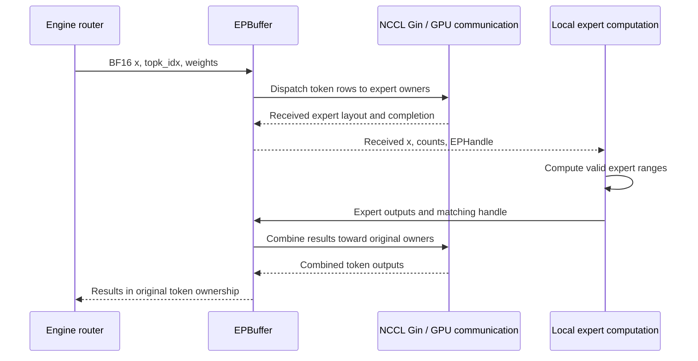

import Source from '../../../components/Source.astro';

## The operation and configuration

A **mixture-of-experts (MoE)** layer selects a few expert networks for each token instead of running every expert. **Expert parallelism** puts different experts on different GPUs. This saves no communication by itself: tokens must reach the GPUs holding their selected experts and results must return.

Trace the BF16 branch of DeepEP's <Source project="deepep" path="tests/ep/test_ep.py" label="EP correctness test" /> with a single host, two NVLink-connected Hopper-or-newer GPUs, two ranks, eight experts, top-2 selection, hidden width 4096, and capacity 128 tokens per rank. Use an expanded expert layout, expert alignment 1, `do_cpu_sync=True`, and no deferred epilogue for the initial reading. These are selected API parameters for a small synthetic trace, not an assertion about the test's defaults or a benchmark. No model weights are required: the test substitutes synthetic routing and expert outputs to isolate communication correctness.

With `--num-tokens 128`, the test constructs 128 active tokens on rank 0 and 127 on rank 1, while both buffers use the same capacity of 128. The test enumerates BF16/FP8, alignment, and stream variants rather than exposing a switch for only this exact branch. Its <Source project="deepep" path="deep_ep/include/deep_ep/layout/ep/workspace.cuh" label="workspace layout" /> requires the expert count to divide across ranks; eight experts over two ranks satisfies that structural requirement. This inspection does not replace running the selected kernel configuration on the required hardware.

The DeepEP release requires a compatible CUDA toolchain, PyTorch, DeepJIT, and NCCL as described in its <Source project="deepep" path="README.md" label="requirements" />. The pinned NCCL source shows the backend interface, while a runtime installation must satisfy DeepEP's stated version and shared-library requirements. This source walkthrough does not certify the two independent commits as a tested runtime pair.

## Dispatch and combine

## Follow the layer

1. **Establish participants.** Each process joins an EP process group. A rank is a group member, normally associated with a GPU in this trace. <Source project="deepep" path="deep_ep/comm/handle.py" label="communicator handling" /> can reuse a communicator or create a managed one. All ranks must agree on the communication contract and capacity.
2. **Allocate workspace.** <Source project="deepep" path="deep_ep/buffers/ep.py" label="EPBuffer" /> allocates communication resources for the group. With eight experts over two ranks, this example has four local experts per rank. The buffer belongs to communication; expert weights and computation belong to the caller.
3. **Choose experts.** The test constructs scores and selects top-k indices. For one token, experts 1 and 6 might live on different ranks. Dispatch duplicates/routes the activation as needed; it does not compute the model's learned router.
4. **Dispatch.** Call `dispatch` with activations, indices, and weights. Ordinary dispatch returns five items: received activations, received expert indices, received weights, the `EPHandle`, and an event wrapper. The expanded layout arranges incoming rows for expert computation. Combine needs the matching handle and layout, not just a tensor of the right shape. If selecting deferred epilogues instead, dispatch returns only an event wrapper whose wait hook produces the four data/handle items.
5. **Wait and compute.** The initial configuration uses CPU-known receive sizes. If choosing asynchronous operation, honor event dependencies before consuming output. The test generates stand-in expert outputs; a real engine would run local expert matrix operations on valid received ranges.
6. **Combine.** Call `combine` with expert outputs and the matching handle. Ordinary combine returns the reduced activations, returned top-k weights, and an event wrapper. Routing/reduction returns contributions to original token owners. The <Source project="deepep" path="deep_ep/utils/refs.py" label="reference implementation" /> makes the expected accumulation easier to inspect. Treat activation reduction and the separate weight output as distinct: the calling model must still implement its gating mathematics.
7. **Retain and retire.** Keep routing indices and buffers valid through their last use. New expert assignments require a fresh routing decision. Complete pending communication before tearing down resources.

## State ownership and failure boundaries

| State | Owner | Boundary to verify |
| --- | --- | --- |
| Token activations and selected experts | Calling engine/test | Input shape, type, and expert indices |
| Communication workspace and layout handle | EPBuffer/caller holding handle | Capacity and lifetime |
| Received rows and expert output tensors | Caller/execution stream | Valid ranges and completion events |
| Communicator and peer topology | NCCL/backend with DeepEP lifecycle | Consistent group and supported transport |

Changing expert distribution without updating routing breaks semantics even if communication succeeds. Capacity mismatch is a different error from an unsupported network path. Event misuse can expose incomplete data without any HTTP-level error. For multi-node variants, add RDMA and verify the scale-out topology; the single-host example does not establish that path.

## Check your understanding

Why can an `EPHandle` from the previous decode step be invalid for the next step even if tensor dimensions are identical?

Answer

Shape equality does not mean tokens selected the same experts. The handle captures routing/layout information and references routing inputs. Reusing it requires the API's routing reuse conditions, not merely an equal batch size or the fact that both operations are decode steps.

## Optional runtime extension

Use DeepEP's documented installation and test launcher on the required GPUs and toolchain. Start with the upstream correctness test and inspect its parser for the selected sizes. Do not interpret synthetic communication results as end-to-end model throughput. No GPU tests were run for this guide.

## Explore the implementation

| Repository chapter | What to inspect |
| --- | --- |
| [Token layouts](/architecture/deepep/token-layouts/) | Worked expert expansion and receive ranges |
| [Stream ordering](/architecture/deepep/streams-and-events/) | Events, deferred epilogues, and safe lifetime |
| [Full operation trace](/architecture/deepep/dispatch-combine-trace/) | Reference-tested routing and accumulation |
