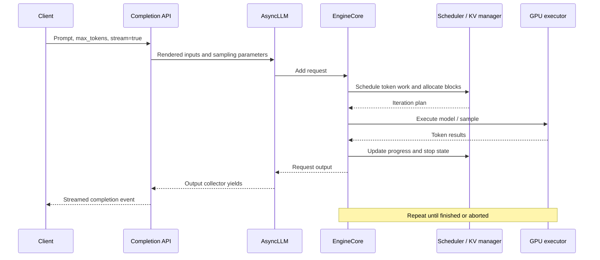

import Source from '../../../components/Source.astro';

## The customer operation

A user asks a text model to finish a sentence. They want the first words quickly, then a steady stream of output. The service must keep enough state to continue the sentence while sharing its GPU with other requests.

We follow vLLM's Python OpenAI-compatible completion endpoint, a decoder-only text model, one engine, one NVIDIA GPU, tensor parallel size 1, no speculative decoding, and no external KV connector. Qwen/Qwen3-0.6B is the example model. Its weights and runtime allocations must fit the available GPU memory. The inspected vLLM revision is listed above; model downloads are separate artifacts and need their own pinned revision for a reproducible runtime experiment.

This is a source-reading walkthrough. No cluster, model download, or GPU is needed to follow it. The code paths are verified by inspection; GPU execution and latency have not been measured here.

## Before the first token

A **[token](/glossary/#token)** is an integer identifying an item in a model's vocabulary. Text becomes tokens before model execution. **[Prefill](/glossary/#prefill)** processes the prompt and builds attention state. **[Decode](/glossary/#decode)** repeatedly advances the output using that accumulated context. An output token is not necessarily a whole word.

The **[KV cache](/concepts/kv-cache/)** stores attention keys and values for previous tokens. It grows as generation proceeds, so the number of active requests is constrained by memory as well as compute.



## Follow the request

1. **Enter the API.** Read <Source project="vllm" path="vllm/entrypoints/openai/completion/api_router.py" label="create_completion" />. The endpoint delegates to the serving implementation. HTTP handling owns the connection and protocol errors; it does not schedule GPU batches.
2. **Render inputs.** <Source project="vllm" path="vllm/entrypoints/openai/completion/serving.py" label="OpenAIServingCompletion" /> creates engine inputs and sampling parameters. `max_tokens` limits output length; stop handling can end generation earlier. The adapter calls the engine client's `generate` method and formats streamed results.
3. **Create request state.** Read `generate` and `add_request` in <Source project="vllm" path="vllm/v1/engine/async_llm.py" label="AsyncLLM" />. Each request gets an output collector. A background handler receives engine output while the request coroutine awaits its own results. This separation lets many connections coexist.
4. **Wait for resources.** In <Source project="vllm" path="vllm/v1/core/sched/scheduler.py" label="Scheduler.schedule" />, find the token budget and request queues. The scheduler tracks how many tokens have been computed versus how many are required. A prompt may span iterations; decode progress competes for the same finite resources. Read [continuous batching](/concepts/scheduling/) at this point.
5. **Reserve context storage.** <Source project="vllm" path="vllm/v1/core/kv_cache_manager.py" label="KVCacheManager" /> looks up reusable prefix blocks and allocates slots. CPU metadata tracks which request owns which logical blocks; the KV tensors themselves reside in execution-side memory.
6. **Run one iteration.** <Source project="vllm" path="vllm/v1/engine/core.py" label="EngineCore.step" /> calls the scheduler, launches the model executor, obtains results, processes pending aborts, and updates scheduler state. <Source project="vllm" path="vllm/v1/worker/gpu_model_runner.py" label="GPUModelRunner.execute_model" /> is the lower-level execution boundary. Async scheduling introduces additional overlap; start with this simple step to understand responsibilities.
7. **Stream and finish.** The <Source project="vllm" path="vllm/v1/engine/output_processor.py" label="output processor" /> tracks text and request completion. The serving adapter emits response events. Generation continues until a stop condition, abort, or error. Prefix caching can keep reusable state after the active request releases ownership.

## Who owns what?

| State | Owner | Lifetime |
| --- | --- | --- |
| HTTP connection and response framing | API/serving layer | Until response or disconnect |
| Output collector and engine-client request tracking | AsyncLLM/output processor | Until finished or aborted |
| Waiting/running status and token progress | Scheduler in EngineCore | Across scheduling iterations |
| Logical KV block allocations | KV cache manager | Across request progress; reusable blocks may remain cached |
| Weights, execution tensors, and GPU KV storage | Executor/worker | Model or cache allocation lifetime |

## When something fails

Cancellation in `AsyncLLM.generate` triggers abort handling. A dead engine is a separate error path; accepting another request at the HTTP layer cannot repair a failed core. Memory pressure can delay or preempt work rather than produce a token immediately. Inspect the <Source project="vllm" path="tests/v1/core/test_scheduler.py" label="scheduler tests" /> for expected state transitions.

## Check your understanding

Find `EngineCore.step` and identify the order of model execution, abort processing, and scheduler output updates. Why process an abort even after GPU work has completed?

<details>
<summary>Answer</summary>

The client can cancel while the GPU runs. GPU completion means the iteration produced results, not that the request is still wanted. The core drains pending aborts before updating the scheduler from model output, allowing request lifecycle state to reflect cancellation.

</details>

## Optional runtime extension

With a compatible vLLM installation, model access, and a supported CUDA GPU with sufficient memory, serve the example model:

```sh
vllm serve Qwen/Qwen3-0.6B --tensor-parallel-size 1 --enforce-eager
```

In another terminal, submit a streaming request:

```sh
curl -N http://localhost:8000/v1/completions \
  -H 'Content-Type: application/json' \
  -d '{"model":"Qwen/Qwen3-0.6B","prompt":"Distributed inference is","max_tokens":32,"stream":true}'
```

These commands illustrate the selected path; they are not a benchmark. Record the model revision, installed packages, GPU, and server configuration before comparing latency. Continue with [the vLLM architecture guide](/architecture/vllm/).

## Explore the implementation

| Repository chapter | What to inspect |
| --- | --- |
| [Request ownership](/architecture/vllm/request-lifecycle/) | Per-request state across the API/core boundary |
| [Scheduling iterations](/architecture/vllm/scheduling/) | Work budgets and actual progress |
| [GPU execution](/architecture/vllm/gpu-execution/) | Persistent batches and prepared tensors |
