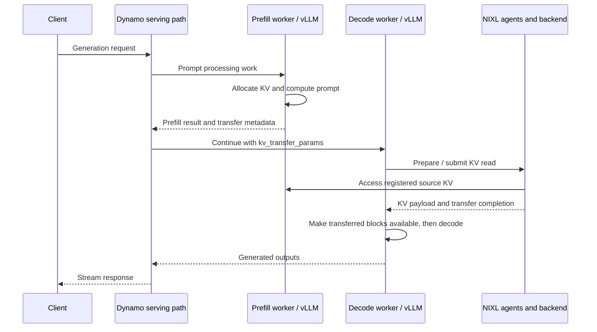

import Source from '../../../components/Source.astro';

## Configuration and purpose

Prompt processing and token-by-token generation stress an inference service differently. Separating them can protect streaming latency and let their capacity scale separately. It adds state transfer, another queue, and a handoff that can fail. The useful question is whether those costs are smaller than the interference being removed.

Use Dynamo's <Source project="dynamo" path="examples/backends/vllm/launch/disagg.sh" label="disagg.sh example" />: Qwen/Qwen3-0.6B, two visible GPUs on one host, decode on GPU 0, prefill on GPU 1, eager execution, `NixlConnector`, producer/consumer roles, and separate system ports. The prefill process publishes KV events. The example does not imply that every Dynamo deployment uses cache-aware routing or this exact backend.

The three pinned source revisions are listed above. They establish the inspected interfaces, not a tested dependency set. A runtime experiment should use the example's matching Dynamo engine environment and record its installed vLLM/NIXL versions; independently checking out three heads does not certify compatibility. Read all steps without hardware.

## The two paths

The diagram abstracts routing and adapter calls into the serving path; it does not mean the HTTP frontend itself copies KV bytes. **Control flow** selects work and communicates descriptors. **Data flow** moves the cached attention tensors through the configured transfer backend.

## Follow the handoff

1. **Initialize both engines.** Read <Source project="dynamo" path="components/src/dynamo/vllm/main.py" label="worker startup" /> beside the launch script. Each engine has its own model execution and KV allocations. Local block numbers are meaningful within that engine; they are not global tensor addresses.
2. **Produce transferable state.** The prefill engine processes the prompt. In <Source project="dynamo" path="components/src/dynamo/vllm/handlers.py" label="backend handlers" />, follow `_prefill_disaggregated_params` and `_build_disaggregated_params`. The adapter returns engine-provided KV transfer metadata with the prefill result.
3. **Forward the contract.** The decode handler extracts `kv_transfer_params` from `disaggregated_params` and supplies it to the engine request. This boundary carries information needed for state retrieval, not the KV payload.
4. **Resolve scheduler and worker responsibilities.** The <Source project="vllm" path="vllm/distributed/kv_transfer/kv_connector/v1/nixl/connector.py" label="NIXL connector facade" /> delegates to mode-specific scheduler and worker classes. In this snapshot, `NixlConnector` aliases the pull/READ connector. The <Source project="vllm" path="vllm/distributed/kv_transfer/kv_connector/v1/nixl/pull_worker.py" label="pull worker" /> is the concrete transfer-side reading path; a push connector is an alternative mode.
5. **Transfer registered memory.** In <Source project="nixl" path="src/core/nixl_agent.cpp" label="nixlAgent" />, follow registration, metadata loading, `createXferReq`, `postXferReq`, and `getXferStatus`. The agent maps descriptors onto a compatible backend. A submitted operation can still be in progress.
6. **Resume only when safe.** Follow <Source project="vllm" path="vllm/distributed/kv_transfer/kv_connector/v1/nixl/base_worker.py" label="get_transfer_results" /> into <Source project="vllm" path="vllm/v1/core/sched/scheduler.py" label="the scheduler's remote-KV handling" />. The connector reports both finished and failed receives; a finished receive alone does not prove that usable state arrived. The scheduler checks failure bookkeeping before marking loaded blocks reusable, and moves the request out of `WAITING_FOR_REMOTE_KVS` for subsequent scheduling. Producer allocations must outlive remote reads; notifications, heartbeats, and expiry bookkeeping coordinate their retention. Returning prefill metadata does not establish transfer completion.
7. **Finish or cancel.** Decode streams generated output. Dynamo's `_DeferredAbort` delays an early decode-side engine abort until the first generation result, which its source identifies as a point after the KV transfer and initial token execution. Canceling the user stream and reclaiming engine allocations therefore need not happen together. Source-side expiry and failure cleanup remain separate lifecycle paths.

## Ownership at the boundary

| State | Responsible component | What must remain valid |
| --- | --- | --- |
| Request placement and continuation metadata | Dynamo routing/adapters | Selected worker identity and handoff parameters |
| Source KV blocks | Prefill engine | Registered source allocations until transfer users finish |
| Destination KV blocks | Decode engine | Reserved destination allocation and correct block mapping |
| Transfer descriptors, remote metadata, operation status | NIXL connector/agents | Compatible registrations, peer metadata, and live handles |

## Failure and verification

A discoverable worker may still have a failed engine or unreachable data path. Separate routing errors, allocation failures, metadata mismatch, backend connection failures, and stalled transfer completion. Collect the configured connector, peer identities, engine logs, and transfer status before changing network settings. A retry that selects another worker cannot assume the old worker's KV blocks exist there.

## Check your understanding

Locate the `NixlConnector` alias and the deferred-abort comment in the linked sources. Why does the decode worker need both metadata and a completion condition?

Answer

Metadata identifies the state and how to access it. Completion establishes that the state can be consumed. Conflating them permits decode to read missing or partially transferred data, or permits cancellation to release memory while a peer is still reading it.

## Optional runtime extension

Use the pinned launch example in its matching Dynamo environment, with two supported GPUs, enough memory for both engines, model access, working runtime/discovery services, NIXL and its chosen backend, and available ports. Consult the example's surrounding setup before launching; its cleanup trap terminates its process group. This walkthrough does not require or perform that deployment. Measure transfer time and tail streaming latency before drawing a benefit claim.

## Explore the implementation

| Repository chapter | What to inspect |
| --- | --- |
| [Dynamo handoff](/architecture/dynamo/prefill-decode/) | Request continuation and ownership |
| [Connector details](/architecture/vllm/kv-connectors/) | Success/failure reporting and scheduler consumption |
| [Transfer mechanics](/architecture/nixl/transfer-lifecycle/) | Descriptor preparation, status, and release |
